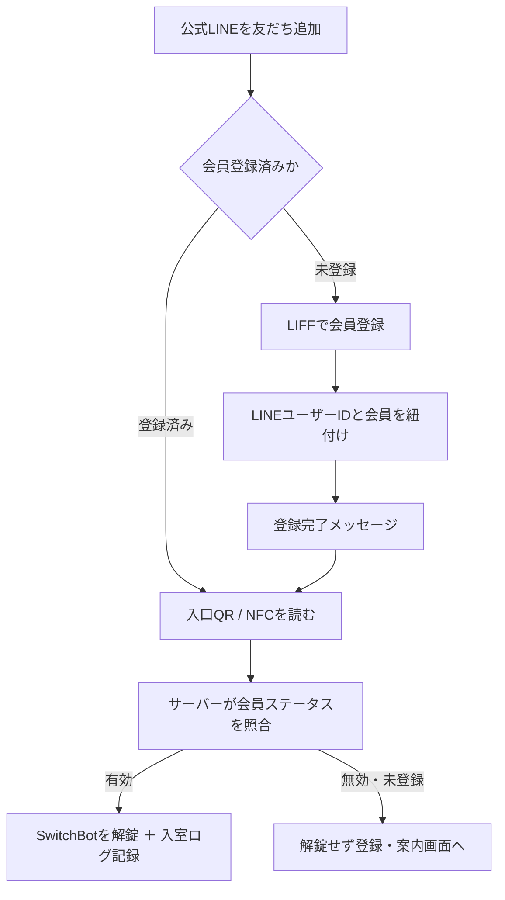
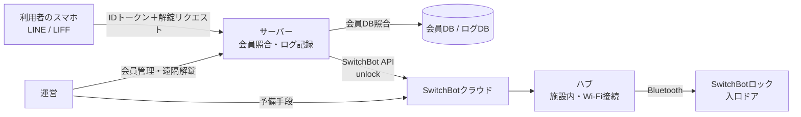

# アーベル 入退室システム 仕様書

- バージョン：0.3（ドラフト、2026-11-08 退室記録と12時間自動退室を決定）
- 作成日：2026-11-08
- 管理方法：本仕様書は GitHub リポジトリで管理し、URLをアーベル公式LINEで公開する。
- 公開範囲の注意：本書は公開版である。認証情報（トークン、シークレット）、デバイスID、物理鍵の保管場所、障害時の迂回手順は本書に記載しない（別途、非公開の運用メモで管理する）。

---

## 1. 概要

アーベル（学生向けコミュニティスペース、無料・24時間／要予約）の入退室を、利用者のスマートフォン1台で完結させるシステム。

- 公式LINEを友だち追加し、LINE内で会員登録をした人だけが、入口ドアを解錠して入室できる。
- 解錠の操作がそのまま入室記録になる（チェックインの別途操作は不要）。
- 鍵の開閉には既設置の SwitchBot スマートロックを使用する。
- 専用アプリのインストール、ICカードの発行、読み取り専用機の設置は行わない。

## 2. 用語

| 用語 | 意味 |
|---|---|
| 会員 | 本システムに登録し、ステータスが「有効」な利用者 |
| LINEユーザーID | LINEプラットフォームがユーザーごとに発行する識別子。本システムの本人確認の主キー |
| LIFF | LINEアプリ内で開くWeb画面（LINE Front-end Framework） |
| アカウント連携 | LINEアカウントと本システムの会員アカウントを紐付ける公式の仕組み（§4-2） |
| ハブ | SwitchBot ハブミニ／ハブ2／ハブ3 のいずれか。ロックをクラウド経由で操作するために必要 |

## 3. 利用者導線

### 3-1. 全体フロー



### 3-2. 画面一覧（LIFF）

| # | 画面 | 内容 | 表示条件 |
|---|---|---|---|
| S1 | 会員登録 | 登録項目の入力、利用規約への同意、登録ボタン | 未登録ユーザー |
| S2 | 登録完了 | 完了通知、入室方法の案内 | 登録直後 |
| S3 | 解錠 | 「解錠する」ボタン（または画面表示と同時に照合→解錠）、解錠結果の表示 | 有効な会員 |
| S4 | 入室不可 | 開かない理由（未登録／停止中）と対処（登録・問い合わせ導線） | 会員でない、または停止中 |
| S5 | マイページ | 登録内容の確認・変更、利用履歴（自分の入室記録） | 会員 |
| S6 | 退室 | 退室ボタンと記録完了表示（退室記録がない場合は入室から12時間で自動退室扱い・§14-2） | 必須 |

管理者画面（Web／詳細は §13）：

| # | 画面 | 内容 |
|---|---|---|
| A1 | 管理者ログイン | 管理者として許可されたLINEユーザーIDでのみログイン可 |
| A2 | ダッシュボード | 本日の入室数・実利用者数、現在入室中の一覧、直近の解錠失敗 |
| A3 | 会員一覧・詳細 | 検索、ステータス変更（有効／停止／退会）、再紐付け、個人の利用歴 |
| A4 | 利用歴 | 全会員の入退室履歴の検索（期間・会員・結果で絞り込み）、CSV書き出し（§15） |
| A5 | ランキング | 利用回数・利用時間のランキング（期間切替つき、§14） |
| A6 | 設定 | クールダウン時間、自動クローズ時刻、管理者の追加・削除 |

公式LINE側の導線：
- リッチメニューに「会員登録」「入室（解錠）」「マイページ」を配置する。
- 仕様書（本書）の GitHub URL を、リッチメニューまたは配信メッセージで公開する。

## 4. LINEアカウントとの紐付け

紐付けは2方式を仕様として持つ。原則は方式A、既存の会員データがある場合は方式Bで移行する。

### 4-1. 方式A：新規登録時にLIFFで紐付け（標準）

1. ユーザーがLIFF画面（会員登録）を開く。
2. LIFFがIDトークンを取得し、サーバーへ送信する。
3. サーバーはLINEプラットフォームの検証エンドポイント（`POST /oauth2/v2.1/verify`）でIDトークンを検証し、LINEユーザーIDを安全に取得する。
   - 画面側で取得した表示名・プロフィール情報をそのまま信用して保存してはならない。
4. サーバーは入力された登録項目とLINEユーザーIDを1つの会員レコードとして保存する。
5. 以後の照合はすべてLINEユーザーIDで行う（パスワードは設けない）。

### 4-2. 方式B：公式「アカウント連携」による既存会員の紐付け

既存の会員ID（会員番号等）が先に存在する場合の連携手順（LINE公式のアカウント連携フロー）。

1. ボットサーバーが、ユーザーのLINEユーザーIDを使って連携トークン発行API（`POST /bot/user/{userId}/linkToken`）を呼ぶ。連携トークンは1回のみ有効、有効期間10分。
2. Messaging APIで連携URLをユーザーに送信する。
3. ユーザーが連携URLから自サービスのログイン／本人確認を行う。
4. ウェブサーバーは自サービスのユーザーIDから nonce を生成する。
   - nonceは予測困難で一度しか使えない文字列とし、長さ10〜255文字、128ビット以上のランダム値をBase64エンコードすることが推奨される。会員IDそのもの等の予測可能な値を nonce に使ってはならない。
   - nonce と自サービスのユーザーIDを紐付けて保存する。
5. ユーザーを `https://access.line.me/dialog/bot/accountLink?linkToken={linkToken}&nonce={nonce}` へリダイレクトする。
6. LINEプラットフォームからWebhookでアカウント連携イベント（LINEユーザーIDと nonce を含む）が届く。
7. サーバーは nonce から自サービスのユーザーIDを引き、LINEユーザーIDと紐付けて保存する。連携完了。
8. 連携解除は、ユーザーの退会時またはLINEの連携解除操作に合わせて、会員レコードのLINEユーザーIDを削除しステータスを変更する。

### 4-3. 紐付けに関するルール

- 1つのLINEユーザーIDに紐付けられる会員は1つだけとする（重複登録の防止）。
- 1人の会員が複数のLINEアカウントを紐付けることはできない。
- 機種変更等でLINEアカウントが変わった場合は、運営が本人確認のうえ再紐付けする（手順は非公開の運用メモに記載）。

## 5. 機能要件

| ID | 機能 | 内容 | 優先度 |
|---|---|---|---|
| F1 | 会員登録 | LIFFから登録し、LINEユーザーIDと紐付ける（§4-1） | MVP |
| F2 | 会員照合 | 解錠リクエストごとに、LINEユーザーIDとステータス（有効／停止／退会）を照合する | MVP |
| F3 | 解錠 | 照合OKの場合のみ、サーバーから SwitchBot API の unlock コマンドを実行する | MVP |
| F4 | 入室ログ | 解錠の成功・失敗を、時刻・会員・理由とともに記録する | MVP |
| F5 | 会員管理（運営用） | 会員一覧、ステータスの変更（有効／停止／退会）、再紐付け | MVP |
| F6 | 退室記録 | 室内QR／LIFFの退室ボタンで退室を記録する。退室記録がない場合は入室から12時間で自動退室扱いにする（§14-2） | MVP |
| F7 | 利用集計 | 月次の延べ入室数・実利用者数の集計出力（協賛報告用） | Phase 2 |
| F8 | 予約連動 | 予約がある時間帯のみ解錠可能にする | Phase 3 |
| F9 | ゲスト解錠 | 期限付きワンタイム解錠（イベント時等） | Phase 3 |
| F10 | 管理者画面 | ダッシュボード、会員管理、利用歴、設定（ §13） | MVP（一部）〜Phase 2 |
| F11 | ランキング | 利用回数ランキング、利用時間ランキング（ §14） | 回数・時間ともMVPから可（時間は退室記録＋12時間自動退室が前提） |
| F12 | 利用歴の書き出し | 管理者が利用歴をCSVで書き出す（ §15）。管理画面（CMS）上の操作で完結する | Phase 2 |

非機能要件：
- 解錠操作は、利用者が入口で待つ前提で、照合から解錠まで数秒以内を目標とする。
- 短時間の連続解錠リクエストにはクールダウン（初期値30秒）を設け、二重記録と誤作動を防ぐ。
- 解錠できなかった場合、画面に理由と次の行動（登録する／問い合わせる）を必ず表示する。

## 6. システム構成



構成要素：
- LIFFアプリ（登録・解錠・マイページ画面）
- サーバー（照合、解錠APIの呼び出し、ログ記録、管理機能）。Google Apps Script 等の無料で運用できる基盤を第一候補とする。
- 会員DB／ログDB（§7）
- SwitchBotクラウド／ハブ／ロック（既設置）

## 7. データ仕様

### 7-1. 会員（members）

| 項目 | 型 | 備考 |
|---|---|---|
| member_id | 文字列 | システム発行の会員ID（主キー） |
| line_user_id | 文字列 | LINEユーザーID（ユニーク、紐付け時に設定） |
| name | 文字列 | 氏名（登録項目の詳細は未確定・確認事項） |
| status | 列挙 | active（有効）／ suspended（停止）／ withdrawn（退会） |
| registered_at | 日時 | 登録日時 |
| linked_at | 日時 | LINE紐付け日時 |
| updated_at | 日時 | 最終更新 |

※ 登録項目（大学・学年・連絡先など）は確定次第、本表を更新する。

### 7-2. 入退室ログ（access_logs）

| 項目 | 型 | 備考 |
|---|---|---|
| log_id | 文字列 | 主キー |
| member_id | 文字列 | 未登録者の試行は null とし、line_user_id を別途記録 |
| line_user_id | 文字列 | リクエスト元のLINEユーザーID |
| type | 列挙 | entry（入室）／ exit（退室）／ auto_exit（12時間自動退室） |
| result | 列挙 | success ／ denied_unregistered ／ denied_suspended ／ error |
| method | 列挙 | qr ／ nfc ／ richmenu |
| created_at | 日時 | リクエスト時刻 |

## 8. 外部API連携

### 8-1. LINE
- LIFF：IDトークンの取得。
- LINEプラットフォーム：IDトークンの検証（`POST /oauth2/v2.1/verify`）。
- Messaging API：友だち追加時の案内、登録完了通知、連携URLの送信（方式B）。
- Webhook：アカウント連携イベントの受信（方式B）、友だち追加／ブロック等のイベント受信。

#### メッセージ通数（課金）の方針（2026-11-08）
LINE公式アカウントでは、プッシュメッセージ等の能動配信だけが通数カウント（課金）対象で、応答メッセージ（Reply API）とLINEチャットの送受信、あいさつメッセージはカウントされない（LINE公式ヘルプ）。これを踏まえ、本システムの確認通知は次の方針とする：
- **確認系（解錠完了、入室・退室の記録完了、登録完了）は原則として通数を消費しない形で出す。** 第一はLIFF画面内の表示（そもそもLINEメッセージではない）。LINEトークに残したい場合は、利用者の操作（リッチメニューのポストバック、QRからの起動に伴うWebhookイベント等）を起点に **Reply API（応答メッセージ）** で返す。
- そのため入室・退室の入口は、Reply を返せるよう「ポストバックを発生させる導線」を標準とする。LIFF単独で完結させる画面操作だけでは Reply Token が得られない点に注意する。
- **システム側から能動的に送る通知（12時間自動退室のお知らせ、各種リマインド等）はプッシュ扱いで通数を消費する。** 原則として送らず、マイページ表示と次回利用時の画面表示で代替する。どうしても送る場合は、その分の通数消費を前提に運営が判断する。
- プッシュの無料枠は料金プラン依存（例：コミュニケーションプランは月200通）であり、確認系を Reply／画面表示に寄せることで枠を広報配信等に温存する。

### 8-2. SwitchBot
- デバイス操作API（v1.1）でロックへ `unlock` ／ `lock` コマンドを送信する。
- 認証はオープントークンとシークレットによる署名方式。認証情報はサーバー側の秘匿領域にのみ置き、クライアント（LIFF画面）へ出さない。
- ロックはBLE機器のため、ハブでクラウドサービスを有効にしておくことが前提条件。
- APIの応答ステータスを確認し、失敗した場合はログに error として記録し、利用者画面にも失敗を表示する（成功と偽らない）。

## 9. セキュリティ要件

- 本人確認はサーバー側で検証したLINEユーザーIDのみを根拠とする。
- 解錠APIはサーバーからのみ呼ぶ。解錠URLの直接公開や、画面内への認証情報の埋め込みは禁止。
- 入口QR／NFCは「画面を開く入口」にすぎず、単体では解錠できない設計とする。
- nonce、連携トークン等の使い捨て値は有効期限と1回限りの制約を守る（§4-2）。
- ログには個人を特定できる最小限の情報のみを記録し、公開リポジトリに実データを置かない。

## 10. 障害時・例外時の動作

| 事象 | システムの動作 | 利用者への表示 |
|---|---|---|
| 未登録者が解錠画面を開いた | 解錠しない | 登録への誘導（S4） |
| 停止中の会員 | 解錠しない | 停止中である旨と問い合わせ先（S4） |
| ハブ／ネット障害 | 解錠APIが失敗し error を記録 | 「開けられませんでした。公式LINEから問い合わせてください」 |
| スマホを持っていない／電池切れ | システム外対応 | 運営が遠隔解錠または現地対応（手順は非公開の運用メモ） |
| 連続リクエスト | クールダウン中は解錠を抑止 | 「解錠済みです」の表示 |
| 退室記録なし | 入室から12時間で自動退室扱いにする（§14-2） | 次回利用時・履歴で「自動退室」と表示 |

## 11. GitHubリポジトリ構成（案）

```text
abel-entry-system/
├─ README.md          … 概要、導線図、本仕様書へのリンク
├─ docs/
│  ├─ spec.md         … 本仕様書
│  └─ design-memo.md  … 設計メモ（公開可否は運営判断。費用・内部事情を含むため非公開リポジトリまたは別管理も可）
└─ (実装コードは別リポジトリ、または同リポジトリの private 範囲で管理)
```

- 仕様書のURL（GitHub）は、確定後に公式LINEのリッチメニューと配信で公開する。
- 認証情報を含む設定ファイルは `.gitignore` 対象とし、誤ってコミットしない運用を徹底する。

## 12. 未確定事項

1. SwitchBotハブの有無と種類。
2. 現行の入退室システムの基盤と、既存会員データの有無（方式Aで新規登録か、方式Bで連携移行か）。
3. 会員登録の入力項目。
4. ~~退室記録（F6）の要否~~ → **決定済み（2026-11-08）：取る。取り漏れは12時間で自動退室扱い。**
5. GitHubアカウント／リポジトリ名と、設計メモの公開範囲。
6. ~~利用時間ランキングのための退室時刻の取り方~~ → **決定済み（2026-11-08）：退室も記録を取り、取れていない場合は入室から12時間で自動退室扱い（§14-2）。**
7. ランキングの公開範囲（管理者のみか、会員にも見せるか。見せる場合は表示名の扱い）。

---

## 13. 管理者画面

### 13-1. 管理者認証
- 管理者画面は一般のWeb画面とし、ログインできるのは「管理者」として登録されたLINEユーザーIDのみとする（LIFF／LINEログインで照合）。
- 管理者の追加・削除は A6 設定画面から行う。最低1名の管理者を常に残す。

### 13-2. ダッシュボード（A2）
- 本日の入室回数（成功した entry の件数）と実利用者数（重複を除いた人数）。
- 現在入室中の一覧（入室済みで退室・自動クローズされていない会員、入室時刻つき）。
- 直近の解錠失敗（未登録・停止・エラー）を新しい順に表示し、現場の詰まりに気づけるようにする。

### 13-3. 会員管理（A3）
- 会員を氏名・会員IDで検索できる。
- 会員詳細で登録内容、ステータス、紐付いたLINEユーザーID、個人の利用歴（新しい順）を表示する。
- 操作：ステータス変更（有効／停止／退会）、LINEアカウントの再紐付け、メモの記録。

## 14. ランキング仕様

### 14-1. ランキングの種類
| ランキング | 定義 | 必要なデータ |
|---|---|---|
| 利用回数ランキング | 期間内の入室成功回数が多い順 | 入室ログのみ（MVPから可能） |
| 利用時間ランキング | 期間内の滞在時間の合計が多い順 | 入室＋退室のペア（§14-2） |

- 期間は「今月」「先月」「全期間」を切り替えられるようにする（初期表示は今月）。
- 表示は上位10名＋同点の扱いを明記する（同点は同順位）。
- 集計対象はステータスが有効な会員のみとし、退会者は対象外とする（過去分の扱いは運営判断で変更可）。

### 14-2. 滞在時間の計算と退室のルール（決定済み・2026-11-08）
- 退室も記録を取る。利用者は退室時にLIFFの退室ボタン、または室内QRから退室を記録する。
- 滞在時間は「退室時刻 − 入室時刻」で計算し、入室と退室を1組（セッション）として §7-3 の stays に保持する。
- **退室記録がない場合は、入室時刻から12時間で自動退室扱いにする。** そのセッションの exit_at は「入室時刻＋12時間」、exit_method は auto、stay_minutes は 720（上限）として記録する。
- 自動退室の判定は定期処理（1時間ごと等）で行い、12時間を超えた open セッションを自動で閉じる。
- 自動退室扱いのセッションは実際の退室（actual）と区別し、ランキングや利用歴でも「自動退室」であることが分かるように表示する。実際の滞在が12時間未満でも退室操作を忘れた場合は一律720分になるため、利用時間ランキングはその前提で解釈する。
- 例外処理：open セッションがある会員が新たに入室した場合、先のセッションはその入室時刻で閉じる（exit_method は forced、二重計上を防ぐため）。その後、新しいセッションを開始する。

### 14-3. ランキングの見せ方
- 管理者画面（A5）では全件を氏名つきで表示する。
- 会員向けに公開するかどうかは未確定事項7で決定する。公開する場合は、マイページで「自分の順位と数値」のみ表示を基本とし、他人の氏名を並べる場合は表示名（ニックネーム可）と本人の同意を前提とする。

### 7-3. セッション（stays）※ §7 への追加

| 項目 | 型 | 備考 |
|---|---|---|
| stay_id | 文字列 | 主キー |
| member_id | 文字列 | 会員ID |
| entry_at | 日時 | 入室時刻 |
| exit_at | 日時 | 退室時刻（未退室は null） |
| exit_method | 列挙 | actual（退室操作）／ auto（12時間自動退室）／ forced（再入室時などに強制クローズ）／ open（未退室） |
| stay_minutes | 数値 | exit_at − entry_at（分）。未退室は null |

## 15. 利用歴の書き出し（CSV）仕様

- 管理者は管理画面（A4 利用歴）から、会員の利用歴をCSVファイルで書き出せる。
- 書き出し条件は画面の絞り込み（期間、会員、結果）をそのまま引き継ぐ。全件書き出しも可。
- ファイル仕様：
  - 文字コード：UTF-8（BOM付き、Excelで文字化けしない形式）
  - ファイル名：`abel_usage_YYYYMMDD_YYYYMMDD.csv`（期間を含む）
  - 列：日時、会員ID、氏名、種別（入室／退室）、結果、方法（QR／NFC／リッチメニュー）、滞在時間（分、セッションが閉じている場合のみ）
- ランキング（A5）も同じ形式でCSV書き出しできるようにする（列：順位、会員ID、氏名、利用回数、利用時間（分））。
- 書き出しは個人情報の持ち出しにあたるため、実行できるのは管理者のみとし、誰が・いつ・どの条件で書き出したかを管理ログに残す。
- 書き出したファイルの保管・共有は運営の責任とし、公開リポジトリ等に置かない。
